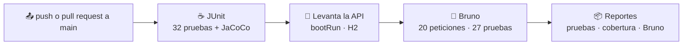
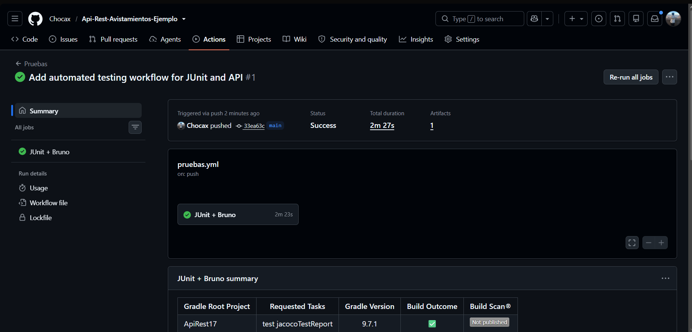
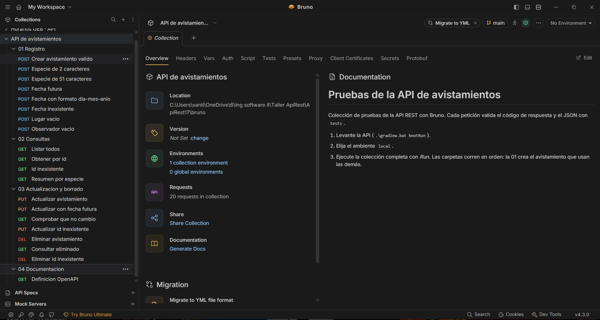

<div align="center">

# 🐦 API REST · Registro de Avistamientos de Aves

**Ingeniería de Software 2 · Universidad El Bosque · 2026-2**
Santiago Pinzón Vásquez


[](https://github.com/Chocax/Api-Rest-Avistamientos-Ejemplo/actions/workflows/pruebas.yml)


</div>

> [!IMPORTANT]
> **📌 Entrega del 11 de noviembre de 2026: Taller 5, Clean Architecture y arquitectura hexagonal.**
> El código se reorganizó con **arquitectura hexagonal (puertos y adaptadores)**. El documento del taller está en:
> **➡️ [docs/Taller5_Arquitectura_Hexagonal.md](docs/Taller5_Arquitectura_Hexagonal.md)**

> [!TIP]
> **⭐ Extra (no lo pide el taller): pruebas de la API con Bruno + GitHub Actions.**
> Lo agregué porque ya lo había implementado en otra materia (Proyecto Núcleo II) y me pareció valioso traerlo aquí: en cada push, GitHub corre solo las 32 pruebas JUnit, levanta la API y le lanza una colección de 20 peticiones de Bruno.
> El resultado se ve en la insignia **Pruebas** de arriba y en la pestaña [**Actions**](https://github.com/Chocax/Api-Rest-Avistamientos-Ejemplo/actions) del repositorio.
> **➡️ [Ver la sección del extra](#-extra-pruebas-de-la-api-con-bruno-y-github-actions)**

> [!NOTE]
> **Entrega del 21 de octubre de 2026 (Sesión 22): Taller de pruebas unitarias y de integración.**
> El documento de justificación que pide el taller está en la carpeta [`docs/`](docs/) como archivo Markdown:
> **➡️ [docs/justificacion-pruebas.md](docs/justificacion-pruebas.md)**

---

## 📖 Descripción

API REST construida con **Java** y **Spring Boot** para registrar y gestionar avistamientos de aves en el campo, cumpliendo con los requisitos del Trabajo en clase (Sesión 17).

Usa **H2 Database** (base de datos en memoria) para el almacenamiento, intercambia información en formato **JSON** y aplica las buenas prácticas de métodos HTTP y códigos de estado.

Para el taller de la Sesión 22 se agregó una **regla de negocio**, una capa de servicio y una suite de **pruebas unitarias y de integración** con medición de **cobertura (JaCoCo)**.

---

## 📋 Contenido

- [Requisitos previos](#-requisitos-previos)
- [Instalación y ejecución](#-instalación-y-ejecución)
- [Swagger UI](#-swagger-ui)
- [Regla de negocio](#-regla-de-negocio)
- [Endpoints y ejemplos de uso (cURL)](#-endpoints-y-ejemplos-de-uso-curl)
- [Pruebas](#-pruebas)
- [Cobertura](#-cobertura-jacoco)
- [⭐ Extra: pruebas de la API con Bruno y GitHub Actions](#-extra-pruebas-de-la-api-con-bruno-y-github-actions)
- [Estructura del proyecto](#-estructura-del-proyecto)

---

## ✅ Requisitos previos

- **Java 17** o superior
- **Git**

No se necesita tener Gradle instalado: el proyecto trae el **Gradle Wrapper**.

---

## 🚀 Instalación y ejecución

**1. Clonar el repositorio**

```bash
git clone <URL_DEL_REPOSITORIO>
cd <NOMBRE_DE_LA_CARPETA>
```

**2. Ejecutar el proyecto**

| Sistema | Comando |
|---|---|
| 🪟 Windows | `gradlew.bat bootRun` |
| 🐧 Linux / 🍎 Mac | `./gradlew bootRun` |

La API queda disponible en **http://localhost:14080**.

> [!TIP]
> **(Opcional) Consola de H2:** http://localhost:14080/h2-console
> JDBC URL: `jdbc:h2:mem:avesdb` · Usuario: `sa` · Sin contraseña

---

## 🧭 Swagger UI

Swagger UI está implementado mediante las dependencias de Gradle (`springdoc-openapi`) para probar los endpoints de forma más intuitiva. La misma herramienta muestra el comando cURL de cada petición.

Con el proyecto corriendo, entra a:

**👉 http://localhost:14080/swagger-ui/index.html**

---

## 📏 Regla de negocio

Un avistamiento **es válido** si:

| Campo | Condición |
|---|---|
| `especie` | Entre **3 y 50** caracteres |
| `fecha` | Formato **`AAAA-MM-DD`**, fecha real y **no posterior a hoy** |
| `lugar` | No vacío |
| `observador` | No vacío |

Si no es válido, **POST** y **PUT** responden **`400 Bad Request`** con el campo que falló:

```json
{
  "campo": "especie",
  "mensaje": "La especie debe tener entre 3 y 50 caracteres (tiene 2)"
}
```

La regla vive en su propia clase, `ValidadorDeAvistamiento`, dentro del núcleo de la aplicación (`aplicacion/servicio`), sin Spring ni JPA, para poder probarla sin levantar la API.

---

## 🔌 Endpoints y ejemplos de uso (cURL)

| Método | Ruta | Descripción | Respuestas |
|---|---|---|---|
|  | `/avistamientos` | Registrar un avistamiento | `201` · `400` |
|  | `/avistamientos` | Listar todos | `200` |
|  | `/avistamientos/{id}` | Ver uno por ID | `200` · `404` |
|  | `/avistamientos/{id}` | Actualizar | `200` · `400` · `404` |
|  | `/avistamientos/{id}` | Eliminar | `204` · `404` |
|  | `/avistamientos/resumen` | ⭐ Bonus: cantidad por especie | `200` |

### 1️⃣ Registrar un avistamiento (POST)

Crea un nuevo registro. Devuelve **`201 Created`** si tiene éxito, o **`400 Bad Request`** si faltan datos o no cumple la regla de negocio.

```bash
curl -X POST http://localhost:14080/avistamientos \
  -H "Content-Type: application/json" \
  -d '{
    "especie": "Colibrí",
    "lugar": "Cerros Orientales",
    "fecha": "2026-09-29",
    "observador": "Santiago"
  }'
```

### 2️⃣ Listar todos los avistamientos (GET)

Devuelve una lista en JSON con todos los avistamientos registrados. **`200 OK`**.

```bash
curl -X GET http://localhost:14080/avistamientos
```

### 3️⃣ Ver un avistamiento específico (GET)

Devuelve un avistamiento según su ID. **`200 OK`** si existe, o **`404 Not Found`** si no se encuentra.

```bash
curl -X GET http://localhost:14080/avistamientos/1
```

### 4️⃣ Actualizar un avistamiento (PUT)

Actualiza por completo un avistamiento existente. **`200 OK`** si se actualiza, **`400 Bad Request`** si los datos no cumplen la regla de negocio, o **`404 Not Found`** si el ID no existe.

```bash
curl -X PUT http://localhost:14080/avistamientos/1 \
  -H "Content-Type: application/json" \
  -d '{
    "especie": "Cóndor de los Andes",
    "lugar": "PNN Los Nevados",
    "fecha": "2026-09-28",
    "observador": "Gabriela"
  }'
```

### 5️⃣ Eliminar un avistamiento (DELETE)

Borra un registro por su ID. **`204 No Content`** si tiene éxito, o **`404 Not Found`** si no existe.

```bash
curl -X DELETE http://localhost:14080/avistamientos/1
```

### ⭐ Punto opcional de bonus: resumen de avistamientos (GET)

Devuelve la cantidad de avistamientos agrupados por especie.

```bash
curl -X GET http://localhost:14080/avistamientos/resumen
```

Funciona llamando al método `contarAvistamientosPorEspecie()` de `AvistamientoJpaRepository` (adaptador de persistencia), que ejecuta esta consulta:

```sql
SELECT a.especie, COUNT(a) FROM Avistamiento a GROUP BY a.especie
```

---

## 🧪 Pruebas

Se usan **JUnit 5**, **Mockito** y **MockMvc** (dependencia `spring-boot-starter-test`).

| Comando | Qué hace |
|---|---|
| `./gradlew test` (Windows: `.\gradlew.bat test`) | Corre todas las pruebas y genera la cobertura al final |

**32 pruebas, todas en verde:**

| Clase (`src/test/java/...`) | Nivel | Pruebas | Qué verifica | Doble usado |
|---|---|:---:|---|---|
| `aplicacion/servicio/ValidadorDeAvistamientoTest` | 🔹 Unitaria | 14 | La regla de negocio con partición de equivalencia y valores límite | Stub `RelojFijo` |
| `aplicacion/servicio/AvistamientoServiceTest` | 🔹 Unitaria | 4 | El servicio y su colaboración con el puerto de persistencia | Mock del puerto `RepositorioDeAvistamientos` (Mockito) |
| `integracion/AvistamientoApiIntegracionTest` | 🔸 Integración | 14 | Los endpoints por HTTP: código, cuerpo y efecto (MockMvc + H2) | Stub `RelojFijo` como `@Primary` |

Reporte de resultados: `build/reports/tests/test/index.html`

> [!NOTE]
> En la entrega de la Sesión 17 había una sola clase, `AvistamientoControllerTest`, con 10 pruebas de caso de éxito y de error por endpoint. Para el taller se reorganizó en `AvistamientoApiIntegracionTest`, que ahora además verifica el cuerpo completo de la respuesta y el efecto de cada operación, y se le sumaron las pruebas unitarias.

---

## 📊 Cobertura (JaCoCo)

| Comando | Reporte |
|---|---|
| `./gradlew test jacocoTestReport` | `build/reports/jacoco/test/html/index.html` |

| Métrica | Antes del refactor (taller de pruebas) | Después del refactor (taller 5) |
|---|---|---|
| Instrucciones | 97 % (286 / 293) | **98 %** (553 / 560) |
| Líneas | 95,6 % (65 / 68) | **97,6 %** (124 / 127) |
| Ramas | 100 % (14 / 14) | **100 %** (14 / 14) |

Lo que queda sin cubrir es lo mismo de antes: `RelojDelSistema.hoy()` (en las pruebas se reemplaza por `RelojFijo`) y el `main` de la aplicación. El análisis está en el [documento de justificación](docs/justificacion-pruebas.md#6-lectura-de-la-cobertura).

---

## ⭐ Extra: pruebas de la API con Bruno y GitHub Actions

<div align="center">

[](https://github.com/Chocax/Api-Rest-Avistamientos-Ejemplo/actions/workflows/pruebas.yml)


</div>

> [!TIP]
> **¿Por qué este extra?** Ya lo había implementado en otra materia (Proyecto Núcleo II, sistema Horarios UEB) y me pareció que valía la pena traerlo aquí. Las pruebas unitarias y de integración verifican el código por dentro; Bruno verifica la API **desde afuera**, como la usaría un cliente real, y GitHub Actions lo repite solo en cada push para que nada se rompa sin que nos demos cuenta.

### 🔄 Qué pasa en cada push



El flujo está en [`.github/workflows/pruebas.yml`](.github/workflows/pruebas.yml). Si algo falla, la insignia se pone en rojo y los reportes quedan descargables en la ejecución, dentro de la pestaña **Actions**.



### 🐶 La colección de Bruno

**Bruno** es un cliente de APIs como Postman, pero guarda cada petición como un archivo de texto (`.bru`) dentro del repositorio. Así las pruebas viajan con el código, se revisan en los commits y no dependen de una cuenta en la nube.

| | Carpeta | Peticiones | Qué verifica |
|:---:|---|:---:|---|
| 📝 | `01 Registro` | 8 | POST válido (**201**) y los 7 casos que la regla rechaza con **400**: especie de 2 y de 51 caracteres, fecha futura, formato `DD/MM/AAAA`, 30 de febrero, lugar y observador vacíos |
| 🔍 | `02 Consultas` | 4 | Lista completa, consulta por id, id inexistente (**404**) y resumen por especie |
| ✏️ | `03 Actualizacion y borrado` | 7 | PUT válido, PUT inválido que no cambia nada, PUT y DELETE de un id inexistente, DELETE (**204**) y consulta posterior (**404**) |
| 📖 | `04 Documentacion` | 1 | Que `/v3/api-docs`, la definición que usa Swagger UI, responda **200** con las rutas |



<details>
<summary><b>▶️ Cómo correrla en su computador</b></summary>

<br>

1. Levante la API: `.\gradlew.bat bootRun`
2. **Con la app de Bruno:** [descárguela](https://www.usebruno.com/downloads), use **Open Collection**, elija la carpeta `bruno`, seleccione el ambiente **local** y dele **Run**.
3. **Desde la terminal** (con Node instalado), en otra ventana:

```bash
cd bruno
npx @usebruno/cli@4.3.0 run -r --env local
```

Debe terminar con `Requests 20 (20 Passed)` y `Tests 27/27`.

</details>

---

## 🗂️ Estructura del proyecto

Arquitectura hexagonal (puertos y adaptadores). Las dependencias apuntan siempre hacia `dominio` y `aplicacion`, que son Java puro.

```
src/
├── main/java/co/edu/unbosque/apirest17/
│   ├── dominio/
│   │   ├── modelo/         Avistamiento, ResumenPorEspecie
│   │   └── excepcion/      AvistamientoInvalidoException
│   ├── aplicacion/
│   │   ├── puerto/entrada/ GestionarAvistamientos, DatosAvistamiento
│   │   ├── puerto/salida/  RepositorioDeAvistamientos, Reloj
│   │   └── servicio/       AvistamientoService, ValidadorDeAvistamiento
│   ├── adaptador/
│   │   ├── entrada/web/    AvistamientoController, ManejadorDeErrores,
│   │   │                   AvistamientoRequest, AvistamientoResponse
│   │   └── salida/
│   │       ├── persistencia/ AdaptadorDePersistenciaAvistamientos,
│   │       │                 AvistamientoEntity, AvistamientoJpaRepository
│   │       └── reloj/        RelojDelSistema
│   └── configuracion/      ConfiguracionDeAplicacion
└── test/java/co/edu/unbosque/apirest17/
    ├── aplicacion/servicio/  AvistamientoServiceTest, ValidadorDeAvistamientoTest
    ├── adaptador/salida/reloj/ RelojFijo
    └── integracion/          AvistamientoApiIntegracionTest
bruno/                                ← extra: colección de pruebas de la API
.github/workflows/pruebas.yml         ← extra: JUnit + Bruno en cada push
docs/
├── Taller5_Arquitectura_Hexagonal.md ← documento del taller 5
├── justificacion-pruebas.md          ← documento del taller de pruebas
└── img/                              ← capturas de pruebas y cobertura
```
