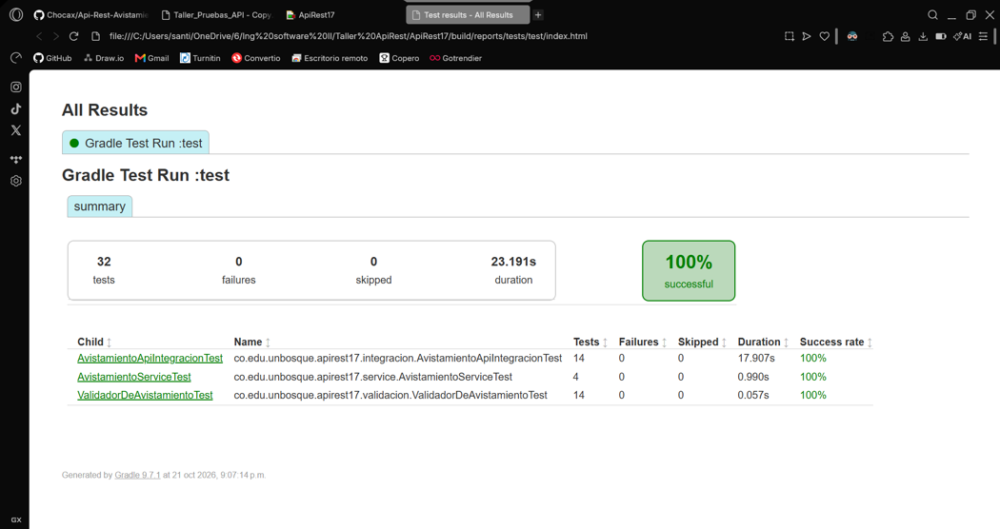
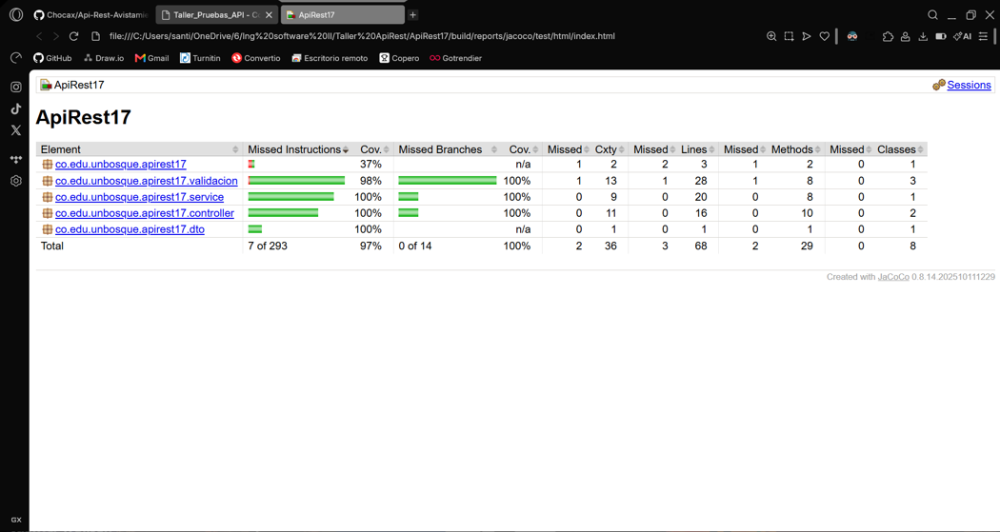
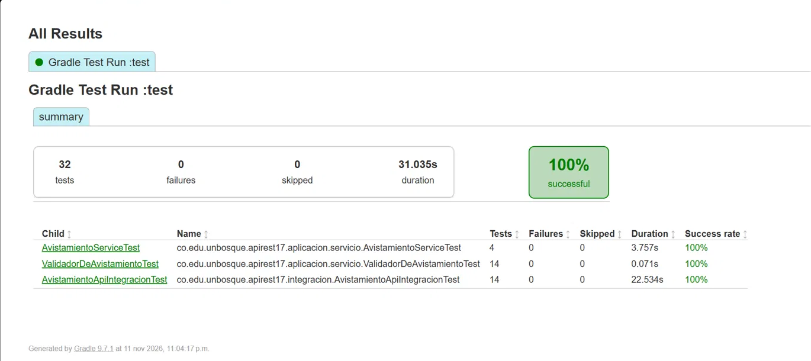
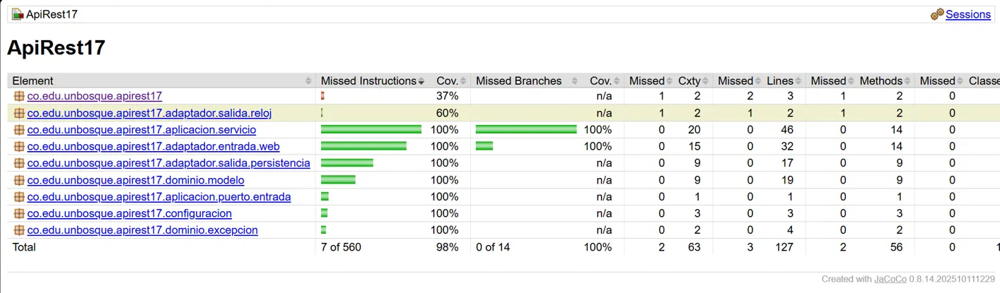

# Taller: Clean Architecture y arquitectura hexagonal

Santiago Pinzón Vásquez · Ingeniería de Software 2 (ISW-2) · Miércoles 11 de noviembre

**Repositorio:** https://github.com/Chocax/Api-Rest-Avistamientos-Ejemplo · **Rama:** `main`

## Parte 1

**1. Cockburn (2005) parte de un problema que ve en las aplicaciones de su época. ¿Cuál es ese problema? ¿Qué es un puerto y qué es un adaptador en su propuesta? ¿Por qué dice que hay una simetría entre el lado del usuario y el lado de la base de datos?**

Cockburn veía que en muchas aplicaciones la lógica del negocio terminaba metida dentro del código de la pantalla. Eso hacía difícil probarlas de forma automática y casi imposible usarlas por lotes o desde otro programa. Del lado de la base de datos pasaba algo parecido: si la aplicación dependía de una base de datos real, el equipo se quedaba quieto cada vez que la base se caía o la estaban cambiando.

Un puerto es la “puerta” por donde la aplicación habla con el exterior. No lo define la tecnología que esté al otro lado, sino el propósito de la conversación, y en la práctica termina siendo una API. Un adaptador es lo que traduce entre esa puerta y una tecnología concreta: una interfaz gráfica, las pruebas automáticas, una base de datos SQL o incluso una base de datos falsa en memoria. Si cambia la tecnología, se cambia el adaptador y la aplicación queda igual.

La simetría está en que, para él, los dos problemas son el mismo: la lógica quedó enredada con lo de afuera. Por eso deja de pensar en “arriba y abajo”, como en las capas de siempre, y piensa en “adentro y afuera”. El usuario y la base de datos quedan los dos afuera y se conectan igual, con un puerto y un adaptador; lo único que cambia es quién empieza la conversación.

**2. Martin (2012) dibuja Clean Architecture como círculos concéntricos. ¿Qué va en cada círculo? Martin enuncia una sola regla para todo el diagrama, la regla de dependencia (The Dependency Rule): ¿qué dice esa regla sobre la dirección en que puede apuntar el código, y qué prohíbe?**

Martin dibuja cuatro círculos. En el centro están las entidades, que son las reglas del negocio más generales y las que menos cambian. Luego vienen los casos de uso, que son lo que hace esta aplicación en particular. Después están los adaptadores de interfaz, que traducen los datos entre el centro y el mundo de afuera (controladores, vistas y acceso a la base de datos). Y en el círculo de afuera están los frameworks y drivers: la base de datos, el framework web y demás herramientas. Entre más adentro, más importante y estable es el código, y Martin aclara que no tienen que ser exactamente cuatro círculos.

La regla de dependencia dice que el código solo puede apuntar hacia adentro. Lo de adentro no puede saber nada de lo de afuera: no puede nombrar clases, funciones ni variables de un círculo exterior, ni recibir datos en el formato en que los entrega la base de datos o un framework.

**3. Según la regla anterior, el caso de uso no puede depender de la base de datos. Pero el caso de uso necesita guardar datos. ¿Cómo resuelve Clean Architecture esa contradicción? Expliquen el mecanismo con un ejemplo (Martin lo trata en el mismo artículo, y también sirve el principio de inversión de dependencias que vieron en SOLID).**

Se resuelve con la inversión de dependencias, la “D” de SOLID. El caso de uso no llama directamente a la base de datos: llama a una interfaz que se define adentro, junto a él, y que dice lo que necesita, algo como “guárdame y búscame avistamientos”. Afuera, la clase que sí conoce la base de datos implementa esa interfaz, y cuando el programa arranca se la entregan al caso de uso. Así, al ejecutarse, el llamado sí llega hasta la base de datos, pero en el código es la clase de afuera la que depende de la interfaz de adentro, y no al revés.

En nuestra API, el servicio de avistamientos solo conoce la interfaz RepositorioDeAvistamientos. La clase que guarda en H2 está en el adaptador de persistencia e implementa esa interfaz, y Spring las conecta al arrancar. Por eso en las pruebas unitarias se le puede pasar al servicio un repositorio falso y no hace falta base de datos.

**4. Comparen la arquitectura hexagonal (Cockburn, 2005), la de cebolla (Palermo, 2008) y Clean Architecture (Martin, 2012). ¿Qué tienen en común las tres? ¿Qué cambia de una a otra: el vocabulario, el número de capas, algo más?**

Las tres buscan lo mismo: dejar las reglas del negocio en el centro y la tecnología afuera, para poder cambiar la base de datos, la interfaz o el framework sin tocar el centro, y para poder probar el negocio sin ellos. En las tres las dependencias apuntan hacia el centro gracias a interfaces que se definen adentro y se implementan afuera. Palermo dice que su idea parte de la misma premisa de Cockburn, y Martin presenta la suya como una forma de juntar todas en una sola.

Lo que cambia es sobre todo el vocabulario y qué tanto detallan el interior. Cockburn habla de puertos y adaptadores y solo distingue adentro y afuera, sin capas internas; el hexágono es solo un dibujo. Palermo pone el modelo del dominio en el centro, con un número de capas alrededor que puede variar, e insiste en que la base de datos es algo externo y no el centro. Martin propone cuatro círculos con nombre propio y lo resume todo en una sola regla, la de dependencia.

**5. Su API es pequeña: unos pocos endpoints y una regla de validación. ¿Se justifica aplicarle Clean Architecture? Argumenten con al menos un costo (trade-off) y un beneficio concretos, y tomen una posición. No hay una única respuesta correcta: se califica el argumento.**

Nuestra posición es que no se justifica aplicarla completa en una API tan pequeña, pero sí vale la pena quedarse con sus ideas más útiles.

El costo es que pasamos de 11 a 19 clases y un avistamiento quedó en tres versiones: la del negocio, la de la base de datos y la del JSON. Hoy, agregar un campo nuevo obliga a tocar siete clases en vez de tres. El mismo Palermo dice que su arquitectura no es para sitios web pequeños, sino para aplicaciones que van a durar años o que son complejas.

El beneficio es que la parte del negocio compila sin Spring ni JPA y sus pruebas corren sin levantar la aplicación ni la base de datos. Además, cambiar H2 por PostgreSQL sería escribir un adaptador nuevo sin tocar el servicio. Ese beneficio aparece justo donde hay algo que cambia, la base de datos y el reloj, así que para esta API bastaba con separar esas dos cosas detrás de interfaces. La versión completa vale la pena cuando el sistema crece o va a durar mucho tiempo.

## Parte 2

**Arquitectura elegida:** arquitectura hexagonal (puertos y adaptadores) de Cockburn. La escogimos porque la API ya tenía un puerto sin saberlo: la interfaz Reloj, con una implementación real y otra para las pruebas.

**Cómo quedó organizado el código:** el código quedó dividido entre adentro y afuera. Adentro está el dominio (el modelo Avistamiento y la excepción de negocio) y la aplicación, con sus puertos de entrada (lo que la aplicación ofrece) y de salida (lo que necesita: guardar avistamientos y saber la fecha de hoy), además del servicio y el validador. Todo eso es Java puro, sin anotaciones de Spring. Afuera están los adaptadores: el controlador REST como adaptador de entrada, y como adaptadores de salida el de persistencia con JPA y H2 y el reloj del sistema. Una clase de configuración conecta los adaptadores con los puertos cuando arranca la aplicación. Ninguna clase de adentro importa algo de afuera.

**Evidencia antes del refactor**

Las 32 pruebas en verde, con 97 % de cobertura de instrucciones y 100 % de ramas.

**Evidencia después del refactor**

Las mismas 32 pruebas en verde, con 98 % de cobertura de instrucciones y 100 % de ramas.

**La API responde igual**

Las rutas, los códigos de respuesta y el JSON de cada endpoint son los mismos que antes del refactor.

Antes del refactor:

Después del refactor:

**Lo más difícil de separar:** la clase Avistamiento, porque antes era al mismo tiempo el modelo del negocio, la tabla de la base de datos y el JSON que devolvía la API. Hubo que partirla en tres clases y convertir de una a otra, cuidando que la API siguiera respondiendo exactamente igual. También costó el resumen por especie, que salía de la consulta en el formato de la base de datos y tuvo que pasar por un objeto propio del dominio antes de volver a armarse como JSON.

## Referencias

Cockburn, A. (2005). *Hexagonal architecture*. https://alistair.cockburn.us/hexagonal-architecture/

Martin, R. C. (2012, 13 de agosto). *The Clean Architecture*. The Clean Code Blog. https://blog.cleancoder.com/uncle-bob/2012/08/13/the-clean-architecture.html

Palermo, J. (2008). *The Onion Architecture: part 1*. https://jeffreypalermo.com/2008/07/the-onion-architecture-part-1/
