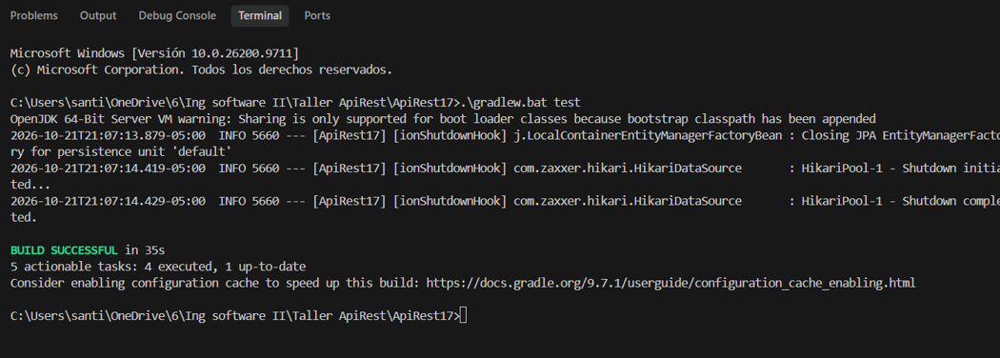
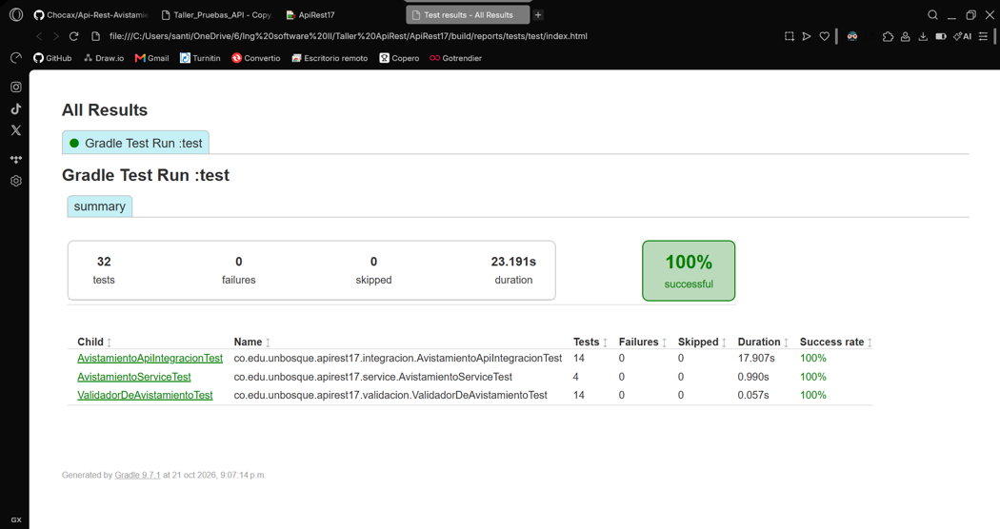
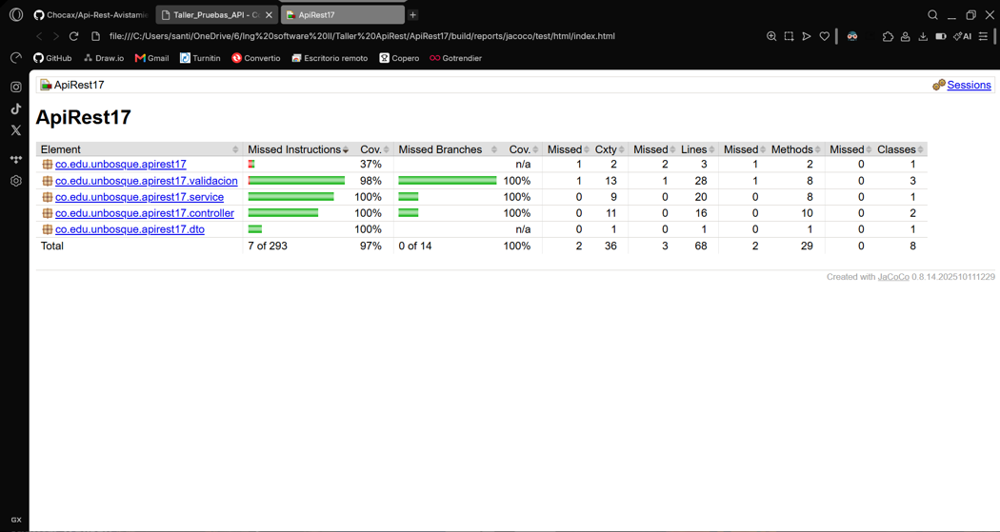

# Taller Pruebas Unitarias y De Integración – Ingeniería de Software 2

**2026-2**

**Santiago Pinzón Vásquez**

Profesor: Jonathan Daniel Briceño Barrera

Ingeniería de Sistemas · Universidad El Bosque

---

## 1. Qué cambió en el código

La API original tenía todo en el controlador: recibía la entidad JPA, la guardaba con el repositorio y la devolvía. La única validación eran anotaciones `@NotBlank` sobre la entidad. No había nada que se pudiera probar sin levantar Spring y la base de datos. Estos son los cambios:

| Cambio | Archivo | Por qué mejora la testabilidad |
|---|---|---|
| **Se extrajo la regla de negocio requerida a una clase propia** | `validacion/ValidadorDeAvistamiento` | Se prueba con `new`, sin Spring, sin HTTP y sin base de datos. Las pruebas corren en milisegundos (la **F** de FIRST). |
| **Se envolvió el reloj del sistema en una interfaz** | `validacion/Reloj`, `RelojDelSistema` | `LocalDate.now()` es no determinista. Al depender de la interfaz `Reloj` (inversión de dependencias, DIP), en las pruebas se inyecta un `RelojFijo`. Eso da **controlabilidad** sobre "hoy" y hace repetibles las pruebas (la **R** de FIRST). |
| **Se creó una capa de servicio** | `service/AvistamientoService` | El controlador quedó delgado. El servicio recibe el repositorio por constructor, así que en la prueba se le puede entregar un doble. |
| **La fecha llega como texto en un nuevo DTO** | `dto/AvistamientoRequest` | Antes, una fecha mal escrita se rechazaba antes de llegar al código. Ahora el validador decide qué es un formato `AAAA-MM-DD` válido, y eso se puede probar unitariamente. |
| **Se agregó un manejador de errores** | `controller/ManejadorDeErrores` | Convierte `AvistamientoInvalidoException` en `400` con el cuerpo `{"campo": ..., "mensaje": ...}`. La respuesta es **observable**: la prueba puede verificar qué campo falló. |

Con estos cambios el controlador solo traduce HTTP, el servicio coordina, el validador decide y el reloj y el repositorio son fronteras reemplazables.

---

## 2. Tabla de casos de la Parte A

Hoy fijo para todas las pruebas (vía `RelojFijo`): **2026-10-21**.

### Especie: particiones `[vacía]`, `[1–2]` inválida, `[3–50]` válida, `[51+]` inválida

| Valor | Longitud | Tipo de caso | Esperado | Por qué este valor |
|---|---|---|---|---|
| `"Colibrí"` | 7 | Representativo de `[3–50]` | Válido | Un nombre real en el centro de la partición válida |
| `"Ab"` | 2 | Límite inválido inferior | 400 `especie` | Último valor antes del borde. Detecta `>= 2` en lugar de `>= 3` |
| `"Ave"` | 3 | Límite válido inferior | Válido | Primer valor válido. Detecta `> 3` en lugar de `>= 3` |
| `"a" × 50` | 50 | Límite válido superior | Válido | Último valor válido. Detecta `< 50` en lugar de `<= 50` |
| `"a" × 51` | 51 | Límite inválido superior | 400 `especie` | Primer valor inválido por arriba |
| `"  Ab  "` | 2 (6 con espacios) | Inválido | 400 `especie` | Comprueba que los espacios no se cuentan como caracteres de la especie |
| `null` | — | Inválido (partición vacía) | 400 `especie` | Campo ausente en el JSON |

### Fecha: particiones `[formato inválido]`, `[fecha ≤ hoy]` válida, `[fecha > hoy]` inválida

| Valor | Tipo de caso | Esperado | Por qué este valor |
|---|---|---|---|
| `2025-03-15` | Representativo de `[≤ hoy]` | Válido | Una fecha pasada cualquiera |
| `2026-10-21` (hoy) | Límite válido | Válido | El borde exacto: detecta `!fecha.isBefore(hoy)` en lugar de `!fecha.isAfter(hoy)` |
| `2026-10-22` (mañana) | Límite inválido | 400 `fecha` | Primer día no permitido |
| `21/10/2026` | Inválido (formato) | 400 `fecha` | Un formato común en Colombia que la regla no acepta |
| `2026-02-30` | Inválido (formato correcto, fecha inexistente) | 400 `fecha` | Cumple el patrón pero no existe. Por eso se usa `ResolverStyle.STRICT` |

### Lugar y observador: particiones `[vacío]`, `[con texto]`

| Valor | Tipo de caso | Esperado | Por qué |
|---|---|---|---|
| lugar `"   "` | Inválido | 400 `lugar` | Solo espacios: `isEmpty()` lo aceptaría, `isBlank()` no |
| observador `""` | Inválido | 400 `observador` | Cadena vacía |
| (texto en los demás casos) | Representativo válido | Válido | Ya lo cubren todas las pruebas válidas anteriores |

Las pruebas siguen la estructura **AAA**, con comentarios `// Arrange`, `// Act` y `// Assert`. Su nombre dice la condición y el comportamiento esperado, por ejemplo `especieDe51Caracteres_esRechazadaPorEspecie` o `fechaDeManana_esRechazadaPorFecha`.

---

## 3. Por qué cada nivel

**`especieDe2Caracteres_esRechazadaPorEspecie` es unitaria.** Lo que verifica es una decisión lógica (`longitud < 3`) que vive en una sola clase. Levantar Spring, H2 y MockMvc para eso haría la prueba cientos de veces más lenta sin detectar nada nuevo. Por eso los siete casos de la especie y los cinco de la fecha están en la base de la pirámide.

**`crear_conFechaFutura_noLlegaAlRepositorio` es unitaria (del servicio).** Lo que importa es la colaboración entre el servicio y el repositorio: si los datos son inválidos, `save` nunca se llama. Con un mock eso se verifica directamente (`verify(repository, never()).save(any())`). En integración solo se vería indirectamente, contando filas.

**`post_conDatosValidos_responde201YElNuevoIdSePuedeConsultar` es de integración.** Detecta cosas que la prueba unitaria del validador no puede ver, porque están en las fronteras entre componentes:

- que el JSON se deserialice bien al record `AvistamientoRequest` (nombres de campos, la fecha como texto);
- que el controlador realmente invoque al servicio y este al validador (una regla correcta que nadie llama no sirve);
- que la excepción se traduzca a `400` con `campo` y `mensaje`, y no a `500`;
- que JPA y H2 guarden la entidad, generen el `id`, y que el `GET /{id}` siguiente la devuelva con la fecha serializada como `"2026-10-03"`;
- que el código de estado sea `201` y no `200`.

En pocas palabras, la unitaria verifica que la regla está bien escrita y la de integración verifica que la regla está conectada.

---

## 4. Los dobles

| Doble | Tipo | Dónde | Por qué ese tipo |
|---|---|---|---|
| **`RelojFijo`** | **Stub** | Pruebas del validador, del servicio y de integración | Solo necesito que devuelva una respuesta preparada (`2026-10-21`). No necesito verificar cómo lo llamaron, así que un spy o un mock sobraría. Lo escribí a mano porque son cuatro líneas. |
| **`mock(AvistamientoRepository.class)`** | **Mock** (Mockito) | `AvistamientoServiceTest` | Las pruebas tienen expectativas sobre la interacción: `verify(repository, never()).save(...)`, `verify(repository).save(captor)`. Eso es lo que define un mock. Un fake en memoria también serviría para guardar y buscar, pero `JpaRepository` tiene decenas de métodos y habría que implementarlos todos. |
| **`RelojFijo` como `@Primary`** | Stub dentro de la integración | `AvistamientoApiIntegracionTest` | Es la única pieza reemplazada en la integración. Todo lo demás es real. |

**Qué habría pasado sin los dobles:**

- **Sin el stub del reloj**, la prueba "fecha de mañana" tendría que usar `"2026-10-22"` fijo o calcular `LocalDate.now().plusDays(1)`. Con el valor fijo, la prueba pasa hoy y **falla a partir del 22 de octubre**, porque esa fecha deja de ser futura. Con el cálculo, el valor esperado se calcula con la misma lógica que se está probando. Además, la prueba del límite "hoy" podría fallar si se corre justo a medianoche. Sin el stub la prueba no sería repetible.
- **Sin el mock del repositorio**, la prueba del servicio necesitaría una base de datos real. Sería más lenta, ya no sería unitaria, y no podría afirmar directamente que `save` *no* se llamó.

Los dos dobles son posibles por la **inversión de dependencias**: el validador depende de `Reloj` (interfaz) y el servicio de `AvistamientoRepository` (interfaz), y ambos los reciben por constructor.

---

## 5. Lo que no se probó

1. **`RelojDelSistema.hoy()`.** Es una sola línea que devuelve `LocalDate.now()`. Es un *humble object*: se dejó tan simple que no tiene lógica que pueda estar mal. Probarlo sería probar la librería estándar de Java, y la prueba sería no determinista justo en lo que intentamos aislar.
2. **El `main` de `ApiRest17Application` y la prueba `contextLoads()` que venía por defecto.** Eliminé `contextLoads()` porque no tiene ningún assert. Además, las 14 pruebas de integración ya levantan el contexto completo: si no cargara, fallarían todas.
3. **Swagger UI y la consola de H2.** Son herramientas de desarrollo generadas por librerías (springdoc, H2), no comportamiento de nuestra API. Swagger lo usé para explorar a mano, pero eso no es una prueba automatizada: no es autoverificable (la **S** de FIRST).
4. **Todas las combinaciones de campos inválidos a la vez** (por ejemplo especie corta *y* fecha futura *y* lugar vacío). Las pruebas exhaustivas son imposibles (principio 2). El validador reporta el primer campo que falla, y cada partición inválida ya se prueba por separado.
5. **La consulta JPQL del resumen de forma unitaria.** Una consulta contra la base solo tiene sentido probarla contra una base, así que queda en el nivel de integración (`getResumen_agrupaYCuentaPorEspecie`).

---

## 6. Lectura de la cobertura

Comando: `./gradlew test jacocoTestReport`. Reporte en `build/reports/jacoco/test/html/index.html`.

| Clase | Líneas cubiertas | Ramas cubiertas |
|---|---|---|
| `ValidadorDeAvistamiento` | 23 / 23 | 10 / 10 |
| `AvistamientoService` | 20 / 20 | 2 / 2 |
| `AvistamientoController` | 13 / 13 | 2 / 2 |
| `ManejadorDeErrores` | 3 / 3 | — |
| `AvistamientoInvalidoException`, `AvistamientoRequest` | 4 / 4 | — |
| `RelojDelSistema` | 1 / 2 | — |
| `ApiRest17Application` | 1 / 3 | — |
| **Total** | **65 / 68 líneas (95,6 %)** | **14 / 14 ramas (100 %)** · 97,6 % de instrucciones |

**Lo que quedó sin cubrir:**

- **`RelojDelSistema.hoy()`** (la línea `return LocalDate.now();`). Quedó sin cubrir **a propósito**: en todas las pruebas se reemplaza por el stub `RelojFijo`. No hace falta una prueba, por lo explicado en la sección 5. Que esté en rojo confirma que ninguna prueba depende de la fecha real.
- **`ApiRest17Application.main`**. Solo arranca Spring Boot. Las pruebas usan `@SpringBootTest`, que crea el contexto sin pasar por `main`. No vale la pena probarlo.

**Conclusión.** El criterio de cobertura que más me interesa aquí es el de **ramas**, porque la regla de negocio es un conjunto de condiciones (`< 3`, `> 50`, `isAfter`, `isBlank`). El 100 % de ramas en `ValidadorDeAvistamiento` indica que cada condición se ejecutó tanto por verdadero como por falso. Aun así, la cobertura no reemplaza el análisis de valores límite: una prueba con especie de 10 caracteres y otra con 100 también cubrirían las dos ramas de `longitud > 50`, pero no detectarían un `>=` en lugar de `>`. Eso solo lo detectan los casos 50 y 51 de la tabla. La cobertura indica qué código no se ejecutó. No indica si se probó bien (principio 1: las pruebas muestran presencia de defectos, no ausencia).

---

## Evidencias

### Ejecución de las pruebas (`./gradlew test`)

### Reporte de pruebas de Gradle: 32 pruebas, 0 fallos, 100 % exitosas

`build/reports/tests/test/index.html`

### Reporte de cobertura de JaCoCo

`build/reports/jacoco/test/html/index.html`

